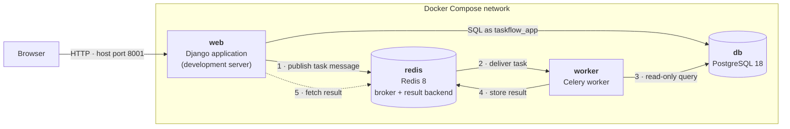
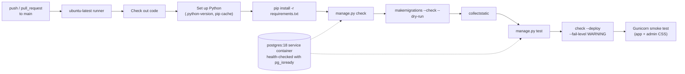
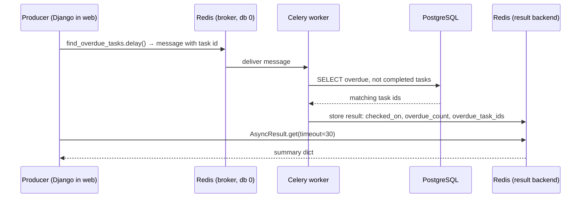
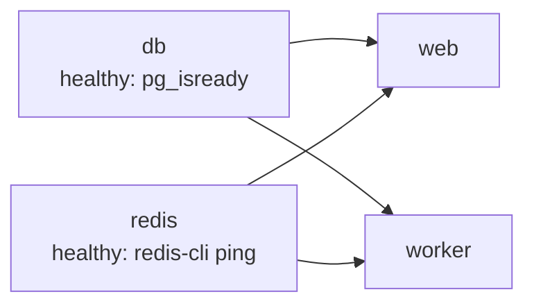

# TaskFlow — A Production-Oriented Django Application & Infrastructure Engineering Project

[](https://github.com/ADITYA8405/TaskFlow/actions/workflows/ci.yml)


TaskFlow is a multi-user task management web application built with Django. It is
also a hands-on infrastructure project: the same application runs as a set of
containerised services — Django, PostgreSQL, Redis, and a Celery worker — and every
change is verified by a PostgreSQL-backed GitHub Actions pipeline.

> **Status:** a development-stage project. It runs locally and in Docker Compose on a
> developer machine. It is **not** deployed anywhere and is not production-ready; see
> [Current limitations](#current-limitations).

---

## Table of Contents

- [Overview](#overview)
- [Key Features](#key-features)
- [Architecture](#architecture)
- [Technology Stack](#technology-stack)
- [Project Structure](#project-structure)
- [Background Task Processing](#background-task-processing)
- [Docker and Container Architecture](#docker-and-container-architecture)
- [Database and Configuration](#database-and-configuration)
- [Backup and Restore](#backup-and-restore)
- [CI and Automated Testing](#ci-and-automated-testing)
- [Getting Started](#getting-started)
- [Deploying to Render and Neon (free tiers)](#deploying-to-render-and-neon-free-tiers)
- [Engineering Decisions and Trade-offs](#engineering-decisions-and-trade-offs)
- [Future Improvements](#future-improvements)
- [License](#license)

---

## Overview

**What it is.** TaskFlow lets each registered user create, organise, and track their
own tasks with a status, a priority, and an optional due date. A dashboard summarises
progress and highlights overdue work.

**The problem it addresses.** Personal task lists are a familiar domain, which keeps the
business logic easy to reason about. That leaves room to focus on the engineering
questions that real backend services have to answer: how users' data is isolated, how
configuration and secrets are managed, how the application talks to a real database,
how slow or periodic work is moved out of the request cycle, and how changes are
verified automatically.

**Why it was built.** To practise backend and infrastructure skills end to end on a
codebase small enough to understand completely — from a Django view down to the
container network and the CI runner.

**What makes it more than a basic CRUD project:**

| Area | What the project demonstrates |
| --- | --- |
| Data isolation | Every task query is scoped to the signed-in user; other users' tasks return 404. |
| Configuration | Environment-driven settings that switch between SQLite and PostgreSQL, default to production-safe values (DEBUG off, HTTPS-only cookies), and fail fast on missing values. |
| Database | PostgreSQL 18 as the containerised application database, accessed by a non-superuser application role. |
| Asynchronous work | Celery with Redis as broker and result backend, running in a dedicated worker container. |
| Containerisation | A Dockerfile and a four-service Docker Compose stack with health-checked start-up ordering. |
| Quality gates | 62 automated tests and a GitHub Actions workflow running Django checks, a migration check, the test suite against PostgreSQL, Django's deployment check, and a Gunicorn static-file smoke test. |
| Secret hygiene | No credentials in the image or in Git; database admin and application credentials kept in separate files. |

---

## Key Features

### Application layer

| Feature | What it provides |
| --- | --- |
| **Registration and authentication** | Sign-up with username, email, and password (Django's password validators apply), plus login and POST-only logout using Django's built-in auth views. |
| **Per-user ownership and isolation** | Each task has an `owner`. List, edit, and delete views filter by `owner=request.user`, so a user can never see or change another user's task — a request for someone else's task ID returns 404 rather than revealing that it exists. |
| **Task CRUD** | Create, edit, and delete tasks through server-rendered forms. Deletion uses a confirmation page and only happens on POST. |
| **Status and priority** | Status is *Pending*, *In Progress*, or *Completed*; priority is *Low*, *Medium*, or *High*. Both are model-level choices, so invalid values are rejected by form validation. |
| **Due dates and overdue tracking** | Optional due date accepted as `DD-MM-YYYY`, `DD/MM/YYYY`, or `YYYY-MM-DD`. A task is overdue when its due date is before today and it is not completed. |
| **Search and filtering** | Case-insensitive title search plus status and priority filters, combinable through query parameters (`?search=`, `?status=`, `?priority=`). Results are ordered newest first. |
| **Dashboard statistics** | Totals for all, completed, pending, in-progress, and overdue tasks, and a completion percentage, computed in a single aggregate database query. |
| **Django admin** | The `Task` model is registered with the Django admin for staff users, alongside Django's built-in user management. |

### Infrastructure and backend engineering

| Feature | What it provides |
| --- | --- |
| **PostgreSQL** | The Docker stack's application database (`postgres:18-alpine`) with a persistent named volume. SQLite remains the zero-configuration default for local development. |
| **Dockerfile** | A reproducible Python 3.13 image containing the application, its pinned dependencies, and its collected static files, with no secrets baked in. Its default command serves the app with Gunicorn. |
| **Production serving** | Gunicorn as the application server and WhiteNoise for compressed, cache-friendly static files; no separate web server is needed to serve CSS and admin assets. |
| **Docker Compose** | One command starts four cooperating services — `web`, `db`, `redis`, `worker` — on a private network, in a dependency-safe order. |
| **Separate web and worker services** | The web server handles HTTP; the Celery worker runs background jobs. They share one image and configuration but run as independent processes that can be restarted or scaled separately. |
| **Redis** | Message broker that queues Celery tasks, and result backend that stores their return values for 24 hours. |
| **Asynchronous task execution** | A read-only Celery task, `find_overdue_tasks`, runs in the worker against PostgreSQL and returns a summary of overdue tasks. |
| **GitHub Actions CI** | Every push and pull request to `main` runs Django's system check, a missing-migration check, `collectstatic`, the full test suite against a PostgreSQL 18 service container, `check --deploy`, and a Gunicorn smoke test that fetches app and admin CSS. |
| **Automated tests** | 62 tests covering models, forms, views, access control, filters, dashboard statistics, authentication, and the Celery task, including its retry and failure behaviour. |

---

## Architecture

### Runtime (Docker Compose)



| Component | Responsibility | Communicates with |
| --- | --- | --- |
| **Browser** | Renders server-generated HTML pages and submits forms. | `web` over HTTP on `127.0.0.1:8001` (mapped to container port 8000). |
| **web** | Runs Django: routing, authentication, views, forms, templates, ORM. Acts as the Celery *producer* when code calls `.delay()`. | `db` on `db:5432`; `redis` on `redis:6379`. |
| **db** | Stores all persistent data: users, sessions, tasks, migration history. | Accepts connections from `web` and `worker` on the Compose network. |
| **redis** | Queues task messages (broker) and holds task results (result backend). Not used for application data. | Reached by `web` and `worker`; not published to the host. |
| **worker** | Celery process that consumes task messages, runs the task code inside Django, and writes the return value to the result backend. | `redis` for messages and results; `db` for task queries. |

All service-to-service traffic uses Compose's internal DNS names (`db`, `redis`). Only
`web` publishes a port to the host.

### CI pipeline (GitHub Actions)

CI runs on GitHub's infrastructure and is independent of the Compose stack. It does not
use Docker Compose, Redis, or a Celery worker.



---

## Technology Stack

| Technology | Purpose in TaskFlow | Why it is used |
| --- | --- | --- |
| **Python 3.13** | Application language (pinned in `.python-version` and the Docker base image). | Current, supported Python release required by Django 6.1. |
| **Django 6.1** | Web framework: ORM, authentication, forms, templates, admin, test runner. | Batteries-included framework with mature security defaults. |
| **PostgreSQL 18** | Application database in Docker and in CI. | Production-grade relational database with strong integrity guarantees and concurrent access. |
| **SQLite** | Default database for local, non-Docker development. | Zero setup for quick local work and test runs. |
| **psycopg 3** | PostgreSQL driver used by Django (`psycopg[binary]`). | Django's recommended modern PostgreSQL adapter. |
| **Celery 5.7** | Defines and executes background tasks in a worker process. | Standard, well-supported task queue for Django projects. |
| **Redis 8** | Celery message broker and result backend (`redis:8-alpine`). | Lightweight, fast, and natively supported by Celery. |
| **Docker** | Builds the application image (`python:3.13-slim`). | Identical runtime on any machine; dependencies isolated from the host. |
| **Docker Compose** | Defines and runs the four-service local stack. | Declarative multi-container orchestration with health-check-aware start-up. |
| **GitHub Actions** | CI workflow in `.github/workflows/ci.yml`. | Integrated with the repository; supports service containers for a real PostgreSQL in CI. |
| **python-dotenv** | Loads a local `.env` file into the environment. | Keeps configuration out of source code for local development. |
| **Django templates + CSS** | Server-rendered HTML with a single hand-written stylesheet. | No frontend build step or JavaScript framework is needed for this UI. |

All Python dependencies, including transitive ones, are pinned to exact versions in
`requirements.txt`.

---

## Project Structure

```text
.
├── .github/
│   └── workflows/
│       └── ci.yml                  # GitHub Actions CI workflow
├── apps/
│   ├── accounts/                   # Registration and authentication
│   │   ├── forms.py                # RegisterForm (UserCreationForm + required email)
│   │   ├── views.py                # register view
│   │   ├── urls.py                 # register/, login/, logout/
│   │   ├── tests.py                # 12 auth tests
│   │   ├── templates/accounts/
│   │   │   ├── login.html
│   │   │   └── register.html
│   │   └── admin.py, apps.py, models.py   # Django scaffolding (no custom models)
│   └── tasks/                      # Task domain
│       ├── models.py               # Task model
│       ├── forms.py                # TaskForm (multi-format due date input)
│       ├── views.py                # dashboard/list, create, edit, delete
│       ├── urls.py                 # task routes
│       ├── tasks.py                # Celery task: find_overdue_tasks
│       ├── admin.py                # registers Task with the admin
│       ├── tests.py                # 50 tests incl. the Celery task
│       ├── migrations/
│       │   ├── 0001_initial.py
│       │   └── 0002_task_owner.py
│       ├── templates/tasks/
│       │   ├── base.html           # shared layout and navigation
│       │   ├── task_list.html      # dashboard, filters, task list
│       │   ├── task_form.html      # create page
│       │   ├── task_edit.html      # edit page
│       │   ├── _form_fields.html   # form fields shared by create/edit
│       │   └── task_confirm_delete.html
│       └── static/tasks/
│           ├── css/style.css       # application stylesheet
│           └── js/app.js           # empty placeholder, not loaded by any template
├── config/                         # Project package
│   ├── __init__.py                 # loads the Celery app at Django start-up
│   ├── celery.py                   # Celery application and autodiscovery
│   ├── settings.py                 # environment-driven settings
│   ├── urls.py                     # root URL configuration
│   └── asgi.py, wsgi.py            # server entry points
├── scripts/
│   ├── db_backup.sh                # pg_dump -Fc to ~/taskflow-backups (manual)
│   ├── db_restore.sh               # restore into an empty, non-live database
│   ├── db_common.sh                # shared connection and safety helpers
│   └── tests/test_db_scripts.py    # script safety tests (stubbed PostgreSQL tools)
├── .dockerignore                   # keeps secrets, venvs, databases out of the image
├── .env.example                    # template for local .env (placeholders only)
├── .gitignore
├── .python-version                 # Python 3.13, used by CI
├── Dockerfile                      # application image
├── compose.yaml                    # web, db, redis, worker services
├── LICENSE
├── manage.py
└── requirements.txt                # pinned dependencies
```

### Responsibilities

| Path | Responsibility |
| --- | --- |
| `apps/accounts/` | User sign-up (`RegisterForm`, `register` view) and wiring of Django's `LoginView` and `LogoutView`. Uses Django's built-in `User` model. |
| `apps/tasks/` | The task domain: model, form, views, URLs, templates, static assets, the Celery task, and most tests. |
| `apps/tasks/models.py` | `Task` with `owner` (FK to user, nullable), `title`, `description`, `due_date`, `status`, `priority`, `created_at`, `updated_at`. |
| `apps/tasks/views.py` | Function-based views, all `@login_required` and owner-scoped. `task_list` also builds the dashboard statistics. |
| `apps/tasks/tasks.py` | `find_overdue_tasks`, a read-only Celery task. |
| `apps/tasks/tests.py` | Tests for the model, form, views, access control, filters, dashboard statistics, and the Celery task. |
| `config/settings.py` | Loads `.env`, requires `DJANGO_SECRET_KEY`, reads `DEBUG`, hosts and HTTPS settings from the environment, configures WhiteNoise static files, selects SQLite or PostgreSQL via `DB_ENGINE`, and defines Celery settings. |
| `config/celery.py` | Creates the Celery app, reads `CELERY_*` settings from Django, and autodiscovers `tasks.py` modules in installed apps. |
| `config/__init__.py` | Imports the Celery app when Django starts so `@shared_task` functions bind to it. |
| `config/urls.py` | Mounts the admin at `/admin/`, task views at `/` (and `/tasks/` for backward compatibility), and auth views at `/accounts/`. |
| `Dockerfile` | Builds the image shared by `web` and `worker`. |
| `.dockerignore` | Excludes `.env*` (except `.env.example`), virtual environments, `.git/`, bytecode, locally collected `staticfiles/`, SQLite files, and personal notes from the build context. |
| `compose.yaml` | Declares the four services, health checks, dependencies, env files, and the PostgreSQL volume. |
| `.github/workflows/ci.yml` | CI workflow definition. |
| `requirements.txt` | Exact-pinned dependency set for the image, CI, and local installs. |
| `.env.example` | Documents every local environment variable with placeholder values. |
| `manage.py` | Django's command-line entry point. |

### Routes

| URL | View | Notes |
| --- | --- | --- |
| `/` | `task_list` | Dashboard and task list (login required). Also available under `/tasks/`. |
| `/create/` | `create_task` | Login required. |
| `/edit/<id>/` | `edit_task` | Owner only; 404 otherwise. |
| `/delete/<id>/` | `delete_task` | Owner only; GET shows confirmation, POST deletes. |
| `/accounts/register/` | `register` | Redirects to login on success. |
| `/accounts/login/` | `LoginView` | Redirects to `/` on success. |
| `/accounts/logout/` | `LogoutView` | POST only; redirects to login. |
| `/admin/` | Django admin | Staff users only. |

---

## Background Task Processing

### Why background processing

Some work should not run inside an HTTP request: it may be slow, it may need to run on a
schedule, or it may not have a user waiting for it at all. A task queue moves that work
to a separate process so web requests stay fast and the work can be retried, scaled, or
scheduled independently.

### Roles in TaskFlow's setup

| Role | In TaskFlow |
| --- | --- |
| **Producer** | Any Django process that calls `find_overdue_tasks.delay()` — for example a Django shell in the `web` container. |
| **Broker** | Redis database `0` at `redis://redis:6379/0`. Holds task messages until a worker takes them. |
| **Worker** | The `worker` service: `celery -A config worker --loglevel=info`. |
| **Task** | `apps.tasks.tasks.find_overdue_tasks`, discovered automatically by `app.autodiscover_tasks()`. |
| **Result backend** | The same Redis instance. Stores each task's return value; results expire after 24 hours (`CELERY_RESULT_EXPIRES`). |

- **Celery** defines tasks, serialises calls into messages, and runs a pool of worker
  processes that execute them.
- **Redis** only transports messages and stores results. It does not hold application
  data; PostgreSQL remains the single source of truth.

### The `find_overdue_tasks` task

```python
@shared_task(
    autoretry_for=(OperationalError,),
    max_retries=5,
    retry_backoff=2,
    retry_backoff_max=60,
    retry_jitter=True,
    acks_late=True,
    track_started=True,
    soft_time_limit=30,
    time_limit=60,
)
def find_overdue_tasks():
    today = timezone.localdate()
    overdue = (
        Task.objects
        .filter(due_date__lt=today)
        .exclude(status='COMPLETED')
        .order_by('due_date', 'id')
    )
    overdue_ids = list(overdue.values_list('id', flat=True))
    logger.info('Found %d overdue task(s) on %s', len(overdue_ids), today.isoformat())
    return {
        'checked_on': today.isoformat(),
        'overdue_count': len(overdue_ids),
        'overdue_task_ids': overdue_ids,
    }
```

- It uses the **same overdue rule as the dashboard**: due before today and not
  completed. Tasks without a due date are never overdue.
- It is **system-wide**: it checks tasks for all users, not just one.
- It is **read-only by design**. It only runs a `SELECT` and returns a JSON-serialisable
  summary. Changing records from a background job would raise questions about retries,
  concurrent edits, and auditing that this project does not yet address, so the task
  reports and leaves decisions to the application. A test asserts that task rows are
  unchanged after it runs.
- It is **idempotent** because it is read-only: running it twice gives the same result
  and changes nothing, so retries and redelivery are safe. Each run reports the state at
  the time it succeeds.

### Reliability

| Option | What it does | Trade-off |
| --- | --- | --- |
| `autoretry_for=(OperationalError,)` | Retries database connection failures only. Programming errors fail immediately. | `OperationalError` also covers permanent faults (wrong password, missing database); those use up the retries (about a minute) before failing. |
| `max_retries=5` | At most 6 attempts, then `FAILURE`. | An outage longer than about a minute still fails the task. |
| `retry_backoff=2`, `retry_backoff_max=60`, `retry_jitter=True` | Waits of up to 2, 4, 8, 16 and 32 seconds, each randomised between 0 and that value so retries do not arrive together. | Results arrive up to about a minute late during an outage. |
| `acks_late=True` | The message is acknowledged after the task finishes, so a task interrupted by the whole worker stopping is redelivered instead of lost. | The task may run more than once, which is safe because it is read-only. With Redis, redelivery after a hard crash happens only after the broker's visibility timeout (1 hour by default). |
| `reject_on_worker_lost` (not set) | If the child process running the task dies, the task is recorded as `FAILURE` (`WorkerLostError`) rather than requeued. | Deliberate: requeuing on every crash could redeliver without limit, outside the retry budget. |
| `track_started=True` | A running task reports `STARTED` instead of `PENDING`. | One extra small Redis write per run. |
| `soft_time_limit=30`, `time_limit=60` | An exception after 30 seconds; the process is killed after 60. | A legitimately slow run would be stopped; the query takes milliseconds. |

PostgreSQL connections also use `connect_timeout=10`, so an unreachable server raises
`OperationalError` after 10 seconds (which the task retries) instead of hanging.

**Failure visibility.** Each retry is logged by the worker at `INFO`
(`… retry: Retry in 4s: OperationalError(...)`) and the state is `RETRY`. A final
failure is logged at `ERROR` with the traceback, and the result backend stores state
`FAILURE` with the original exception for 24 hours; `AsyncResult.get()` re-raises it.
A successful run logs `Found N overdue task(s) on DATE`.

### Execution flow



1. `.delay()` returns immediately with an `AsyncResult` holding the task ID.
2. The worker receives the message, runs the function inside a fully configured Django
   environment, and connects to PostgreSQL with the application role.
3. The return value is written to Redis under the task ID.
4. The caller retrieves it with `result.get()` (or checks `result.state`).

> **Scope:** TaskFlow currently demonstrates **on-demand** task execution. No view
> enqueues the task, and **Celery Beat is not configured**, so nothing runs on a
> schedule. Retries and failure handling are described under [Reliability](#reliability).

---

## Docker and Container Architecture

### Why Docker

Docker gives every developer — and every future deployment target — the same Python
version, system libraries, and dependency set. Compose then turns a multi-process
system (web server, database, broker, worker) into a single declarative file.

### The image

```dockerfile
FROM python:3.13-slim
ENV PYTHONDONTWRITEBYTECODE=1
ENV PYTHONUNBUFFERED=1
WORKDIR /app
COPY requirements.txt .
RUN pip install --no-cache-dir -r requirements.txt
COPY . .
RUN DJANGO_SECRET_KEY=collectstatic-build-only python manage.py collectstatic --noinput
CMD ["gunicorn", "config.wsgi:application", "--bind", "0.0.0.0:8000", "--access-logfile", "-"]
```

- Dependencies are installed **before** the source is copied, so code-only changes reuse
  the cached dependency layer.
- Static files are collected at build time into `/app/staticfiles`. Settings refuse to
  load without a secret key, so the build step passes a placeholder that exists only for
  that command and is not stored in the image. No database is needed.
- The default command runs **Gunicorn** (production). Set `WEB_CONCURRENCY` to choose the
  number of worker processes (Gunicorn's default is 1). Migrations are never run on start.
- The image is tagged `taskflow-web:dev` and is used by both `web` and `worker`. In
  Compose, `web` overrides the command with `runserver` and sets `DJANGO_DEBUG=true` for
  development; the worker overrides it with the Celery command.
- Source code is copied into the image (no bind mount), so code changes require a
  rebuild.
- It still runs as root, and the same image serves development and production.

### Services

| Service | Image | Role | Host port | Health check |
| --- | --- | --- | --- | --- |
| `web` | `taskflow-web:dev` (built) | Django on the development server (`runserver`, `DJANGO_DEBUG=true`) | `8001 → 8000` | none |
| `worker` | `taskflow-web:dev` | `celery -A config worker --loglevel=info` | none | none |
| `db` | `postgres:18-alpine` | Application database | none | `pg_isready -h 127.0.0.1` every 5 s |
| `redis` | `redis:8-alpine` | Celery broker and result backend | none | `redis-cli ping` every 5 s |

### Start-up ordering



`web` and `worker` both declare `depends_on` with `condition: service_healthy` for `db`
and `redis`, so they start only after PostgreSQL accepts connections and Redis answers
`PING`. The PostgreSQL check uses TCP (`-h 127.0.0.1`) deliberately: during first-time
initialisation the official image runs a temporary socket-only server, and a socket-based
check could report healthy too early.

### Persistence

PostgreSQL data lives in the named volume `postgres_data`, mounted at
`/var/lib/postgresql`. It survives `docker compose stop`, `docker compose down`, image
rebuilds, and container recreation. Redis has no named volume: queued messages and stored
results are treated as disposable.

### Networking and exposure

- Services reach each other by service name on the Compose network: Django connects to
  `db:5432` and `redis:6379`.
- Only `web` is published to the host, at `http://127.0.0.1:8001`.
- Redis is **not** published. It has no password, and nothing outside the stack needs it,
  so keeping it on the internal network limits who can read or inject task messages.
  PostgreSQL is not published either.

### Secrets and environment variables

| File | Used by | Contents | In Git? | In image? |
| --- | --- | --- | --- | --- |
| `.env.docker` | `db` | PostgreSQL bootstrap (admin) database, user, and password | No | No |
| `.env.docker.app` | `web`, `worker` | Django secret key and application-role database settings | No | No |
| `compose.yaml` `environment:` | `web`, `worker` | `CELERY_BROKER_URL=redis://redis:6379/0` (not a secret) | Yes | No |

- `.gitignore` excludes `.env` and `.env.*` (except `.env.example`).
- `.dockerignore` applies the same rule to the build context, so env files are never
  copied into the image. Compose injects them at container start instead.
- The `db` container never receives the Django secret key, and `web` and `worker` never
  receive the database admin password.

---

## Database and Configuration

### Environment-based settings

`config/settings.py` reads all deployment-specific values from the environment. A local
`.env` is loaded with `python-dotenv` if present; real environment variables always take
priority.

| Variable | Required | Purpose |
| --- | --- | --- |
| `DJANGO_SECRET_KEY` | Always | Django's signing key. Start-up fails with `ImproperlyConfigured` if missing. |
| `DB_ENGINE` | No | `sqlite` (default) or `postgres`. Any other value raises `ImproperlyConfigured`. |
| `POSTGRES_DB`, `POSTGRES_USER`, `POSTGRES_PASSWORD`, `POSTGRES_HOST`, `POSTGRES_PORT` | When `DB_ENGINE=postgres` | Connection settings. If any is empty, the error names the missing variables but never prints values. |
| `POSTGRES_SSLMODE` | No | libpq TLS mode for the PostgreSQL connection, e.g. `require` for Neon or `verify-full` to also check the certificate. Unset keeps libpq's default (`prefer`), as used locally and by Compose. The backup and restore scripts pass it on as `PGSSLMODE`. |
| `CELERY_BROKER_URL` | No | Broker URL. Defaults to `redis://127.0.0.1:6379/0`; Compose sets `redis://redis:6379/0`. |
| `CELERY_RESULT_BACKEND` | No | Defaults to the broker URL. |
| `DJANGO_DEBUG` | No | `true` for development. **Defaults to `false`**, so a deployment that forgets it is never in debug mode. `.env.example` and `compose.yaml` set it to `true`. |
| `DJANGO_ALLOWED_HOSTS` | In production | Comma-separated host names. Empty by default; while `DEBUG` is on, Django still allows `localhost`, `127.0.0.1` and `[::1]`. |
| `DJANGO_CSRF_TRUSTED_ORIGINS` | No | Comma-separated full origins (e.g. `https://taskflow.example.com`), for forms posted from an origin Django does not treat as its own. |
| `DJANGO_SECURE_SSL_REDIRECT` | No | Production only. Redirect HTTP to HTTPS; defaults to `true`. CI turns it off for the test run only. |
| `DJANGO_BEHIND_TLS_PROXY` | No | Production only. `true` trusts the `X-Forwarded-Proto` header; set it only behind a proxy you control that terminates TLS. Defaults to `false`. |
| `DJANGO_SECURE_HSTS_SECONDS` | No | Production only. **Defaults to `0` (HSTS off)** until HTTPS is verified on the real domain; then raise it gradually. |
| `DJANGO_SECURE_HSTS_INCLUDE_SUBDOMAINS` | No | Production only. Defaults to `false`; enable only once every subdomain is served over HTTPS. |
| `DJANGO_SECURE_HSTS_PRELOAD` | No | Production only. Defaults to `false`; preload-list submission is effectively permanent, so enable only deliberately. |
| `DJANGO_EMAIL_BACKEND` | No | Dotted path of the email backend. Defaults to the console backend when `DEBUG` is on and the SMTP backend when it is off. TaskFlow does not send email yet; configure SMTP host settings before it does. |

When `DJANGO_DEBUG` is `false`, settings also mark session and CSRF cookies `Secure`, and
static files are stored with compressed, content-hashed names, which requires running
`collectstatic` first. When it is `true`, `runserver` serves app static files directly.

`.env.example` is the committed template for local development. It contains placeholders
only.

### Admin and application credentials

The Docker database uses two PostgreSQL roles:

| Role | Defined in | Privileges | Used by |
| --- | --- | --- | --- |
| Bootstrap/admin role (e.g. `taskflow_user`) | `.env.docker` | Superuser created by the PostgreSQL image on first start | `db` initialisation and manual administration |
| `taskflow_app` | `.env.docker.app` | `LOGIN`, `CREATEDB` (for test databases), `CONNECT`/`TEMPORARY` on the database, `USAGE`/`CREATE` on schema `public`. Not a superuser. | `web` and `worker` |

If the application were compromised, it could not alter roles or reach other databases
as a superuser. The application role is created manually (see
[Getting Started](#2-create-the-application-role)); Compose does not create it.

### Why secrets are not committed

Credentials in Git persist in history, are copied to every clone, and are hard to
revoke. TaskFlow keeps them in ignored files, injects them at runtime, and uses only
disposable, clearly labelled values in CI.

### Migrations

Schema changes are tracked in `apps/tasks/migrations/` (`0001_initial`,
`0002_task_owner`) alongside Django's built-in app migrations. Migrations are applied
explicitly with `manage.py migrate`; containers do not apply them automatically on
start. CI fails if a model change has no matching migration.

## Backup and Restore

TaskFlow's data lives in PostgreSQL. Two scripts in `scripts/` back it up and restore it
safely. Both are manual: there is no schedule and no off-site copy.

### What a backup contains

A backup is a complete logical copy of **one database**: every table's schema and data,
indexes, constraints, sequences and their current values, and the `django_migrations`
history. For TaskFlow that includes:

- **users**: usernames, email addresses, and **password hashes** (`pbkdf2_sha256`);
- **sessions**: `django_session` rows, whose keys act as login credentials until they
  expire;
- **tasks**, the admin log, permissions, and content types.

It does **not** contain PostgreSQL roles or their passwords, server settings, Redis
data, `.env` files, the Django secret key, or static files.

### Why the custom format

`pg_dump -Fc` writes one compressed file that `pg_restore` can **inspect without
restoring** (`--list`), restore selectively, and restore inside a single transaction.
A plain SQL dump has none of these properties and is larger.

### Live database vs restore target

| | Live database | Restore target |
| --- | --- | --- |
| What it is | The database TaskFlow uses (`POSTGRES_DB`, `taskflow` in this project) | A separate, **empty** database you create for the restore, e.g. `taskflow_restore_check` |
| Backup script | Reads it (read-only `pg_dump`) | — |
| Restore script | **Refuses** it, by configured name and by the name recorded in the archive | Restores into it only if it exists and contains no objects |
| Disposable? | **No** | Yes, once you have checked it; drop it yourself, by exact name |

The scripts never create, drop, or clean a database, and never use `pg_restore --clean`
or `--create`.

### Back up

```bash
# Database from .env (or POSTGRES_* in the environment), using local client tools
scripts/db_backup.sh

# The Docker Compose db service (runs pg_dump inside the container; no host tools needed)
scripts/db_backup.sh --compose
```

Each run writes `~/taskflow-backups/taskflow-<label>-YYYYMMDD-HHMMSS.dump` and a
matching `.sha256` checksum (label `local` or `docker`; change it with `--label`, the
directory with `--dir` or `TASKFLOW_BACKUP_DIR`). The script:

- dumps into a temporary file and keeps it only if `pg_dump` succeeds and `pg_restore`
  can read the result, so a failed run leaves nothing that looks like a backup;
- never overwrites an existing file, and refuses directories inside the repository;
- creates files with mode `600` in a directory with mode `700`;
- passes the database password only through `PGPASSWORD` to `pg_dump`, never on a
  command line or in its output, and `POSTGRES_SSLMODE` (if set) as `PGSSLMODE`.

Host mode needs PostgreSQL client tools at least as new as the server (18).

### Verify an archive

```bash
cd ~/taskflow-backups
shasum -a 256 -c taskflow-local-20261125-205626.dump.sha256   # Linux: sha256sum -c
pg_restore --list taskflow-local-20261125-205626.dump | head -12   # header: dbname, versions
pg_restore --list taskflow-local-20261125-205626.dump | grep -c ' TABLE DATA '   # 11 tables
```

### Restore into a disposable database

1. Create an **empty** target database. Pick a new name; never reuse the live one.

   ```bash
   createdb -h 127.0.0.1 -U taskflow_user taskflow_restore_check          # local server
   docker compose exec db sh -c 'createdb -U "$POSTGRES_USER" taskflow_restore_check'   # Compose
   ```

2. Restore. `--target` is required; there is no default.

   ```bash
   scripts/db_restore.sh --target taskflow_restore_check ~/taskflow-backups/taskflow-local-20261125-205626.dump
   scripts/db_restore.sh --compose --target taskflow_restore_check ~/taskflow-backups/taskflow-docker-....dump
   ```

Before restoring, the script checks the `.sha256` checksum (when present), that the
file is a valid archive, that the target is not the live database or a system database,
and that the target exists and is empty. It then runs `pg_restore --single-transaction
--exit-on-error --no-owner --no-acl`: the restore either completes or is rolled back
completely, and the script exits non-zero with an error. Objects are owned by the role
that restores them and grants are not restored, so a restored database that an
application role will use needs its privileges granted again.

### Verifying a restore

```bash
# 1. Row counts: run on both databases and compare
for db in taskflow taskflow_restore_check; do
  echo "== $db"
  psql -h 127.0.0.1 -U taskflow_user -d "$db" -At -c "
    SELECT 'auth_user', count(*) FROM auth_user UNION ALL
    SELECT 'tasks_task', count(*) FROM tasks_task UNION ALL
    SELECT 'django_migrations', count(*) FROM django_migrations ORDER BY 1"
done

# 2. Django sees a fully migrated schema and can read the data
POSTGRES_DB=taskflow_restore_check python manage.py migrate --check
POSTGRES_DB=taskflow_restore_check python manage.py shell -c \
  "from apps.tasks.models import Task; print(Task.objects.count())"

# 3. Remove the disposable database when finished (exact name; never the live one)
dropdb -h 127.0.0.1 -U taskflow_user taskflow_restore_check
```

The live database changes after a backup, so compare counts promptly or expect
differences that match activity since the backup.

**Recovering for real** is a deliberate manual step: restore into a new database, verify
it as above, then point `POSTGRES_DB` at it (or rename databases during downtime). The
restore script will not write over the live database.

### Protecting backup files

Backups contain personal data, password hashes, and session keys, so treat them like
the `.env` files:

- keep them outside the repository (the backup script enforces this; `*.dump` is also in
  `.gitignore` and `.dockerignore`);
- keep permissions at `600` for files and `700` for the directory;
- encrypt a backup before copying it off this machine, and do not attach it to tickets
  or chat;
- delete old backups deliberately once they are no longer needed. A restored copy of
  `django_session` still contains valid sessions until they expire.

---

## CI and Automated Testing

### Workflow: `.github/workflows/ci.yml`

| Aspect | Configuration |
| --- | --- |
| Triggers | `push` and `pull_request` to `main` |
| Runner | `ubuntu-latest`, 15-minute timeout, `contents: read` permissions |
| Python | Version read from `.python-version` (3.13) via `actions/setup-python@v7`, with pip caching keyed on `requirements.txt` |
| Database | `postgres:18` service container, health-checked with `pg_isready` before steps run |
| Configuration | Job-level environment variables with disposable CI-only values; `DB_ENGINE=postgres`; `DJANGO_DEBUG` unset, so production settings apply |
| Install | `python -m pip install -r requirements.txt` |
| Step 1 | `python manage.py check` — Django system checks; also proves settings load from the environment |
| Step 2 | `python manage.py makemigrations --check --dry-run` — fails if models and migrations are out of sync |
| Step 3 | `python manage.py collectstatic --noinput` — required because the job uses production static storage |
| Step 4 | `python manage.py test` — creates a test database on PostgreSQL, runs all tests, drops it. Runs with production settings except `DJANGO_SECURE_SSL_REDIRECT=false`, because Django's test client speaks plain HTTP |
| Step 5 | `python manage.py check --deploy --fail-level WARNING` — fails on any deployment warning. Uses a synthetic environment: a long placeholder key, a placeholder host, and check-only HSTS values (`DJANGO_SECURE_HSTS_SECONDS=1`, include-subdomains and preload `true`). Real deployments keep HSTS off (`0`, `false`, `false`) until HTTPS is verified |
| Step 6 | Starts Gunicorn and fetches `/static/tasks/css/style.css` and `/static/admin/css/base.css` through WhiteNoise, sending `X-Forwarded-Proto: https` as a TLS proxy would |
| Step 7 | `python -m unittest discover -s scripts/tests` — backup and restore script safety tests with stubbed PostgreSQL tools |

Redis and Celery workers are not needed in CI: the Celery tests call the task with
`.apply()`, which executes it in-process without a broker. Under `.apply()`, retries run
immediately without waiting for the back-off delay, so the retry tests are fast.

### Test suite

62 tests built on Django's `TestCase`:

| Area | Tests |
| --- | --- |
| Task model | 4 |
| Task form, including date formats and invalid choices | 8 |
| Anonymous access redirects | 2 |
| Task list, create, edit, delete views, including cross-user 404s | 13 |
| Search and filtering | 8 |
| Dashboard statistics | 5 |
| Celery task: overdue, completed, not-yet-due, no due date, read-only, repeat runs, success log | 6 |
| Celery reliability: transient retry then success, failure after the retry limit, no retry for programming errors, task options | 4 |
| Registration | 5 |
| Login and logout | 7 |

### Verified results

- **Locally:** the original 56 tests pass on SQLite, inside the Docker `web` container
  against PostgreSQL 18, and against a disposable PostgreSQL 18 container using the CI
  configuration. The 62-test suite, including the Celery reliability tests, passes on
  SQLite and on PostgreSQL 18.6.
- **Backup and restore:** a backup of the local PostgreSQL `taskflow` database was
  restored into a new, empty disposable database. All 11 tables matched the source in
  row count and content hash, as did sequences, indexes, constraints, and the 20 applied
  migrations; `migrate --check` passed against the restored database, and the
  disposable database was then dropped. A restore of a deliberately corrupted archive
  failed, rolled back, and left the target empty.
- **Retry behaviour with a real worker:** with the database unreachable, a worker logged
  five retries with randomised waits within the 2/4/8/16/32-second ceilings, then an
  `ERROR` and a stored `FAILURE`.
- **GitHub Actions:** the first workflow run on `main` (commit `fc9b9d4`) passed all steps,
  including 56 tests on Python 3.13 with the PostgreSQL 18 service. The badge at the top of
  this README shows the latest status.

---

## Getting Started

### Prerequisites

- Git
- Python 3.13 (for local development)
- Docker with Docker Compose v2 (for the container stack)

### Clone the repository

```bash
git clone https://github.com/ADITYA8405/TaskFlow.git
cd TaskFlow
```

### Option A — Local development (SQLite)

The quickest way to run the web application. Redis and Celery are not required.

```bash
python3.13 -m venv venv
source venv/bin/activate            # Windows: venv\Scripts\Activate.ps1
python -m pip install -r requirements.txt
cp .env.example .env                # Windows: Copy-Item .env.example .env
```

Generate a secret key and paste it into `.env` as `DJANGO_SECRET_KEY='...'`:

```bash
python -c "from django.core.management.utils import get_random_secret_key as k; print(k())"
```

Keep `DJANGO_DEBUG=true` and `DB_ENGINE=sqlite`, then:

```bash
python manage.py migrate
python manage.py createsuperuser    # optional, for /admin/
python manage.py runserver
```

Open http://127.0.0.1:8000/.

> **Existing `.env` files:** settings now default to `DEBUG` off. If your `.env` predates
> `DJANGO_DEBUG`, add `DJANGO_DEBUG=true`; otherwise `runserver` rejects requests (empty
> `ALLOWED_HOSTS`) and redirects to HTTPS.

To use a local PostgreSQL server instead, set `DB_ENGINE=postgres` and fill in the
`POSTGRES_*` values in `.env`. To run Celery outside Docker you would also need a local
Redis server at the `CELERY_BROKER_URL` address.

### Option B — Docker Compose (PostgreSQL, Redis, Celery)

The Docker env files are intentionally not committed. Create them yourself, use strong
generated passwords, and restrict their permissions.

#### 1. Create `.env.docker` and start the database

```dotenv
# .env.docker — read by the db service only
POSTGRES_DB=taskflow
POSTGRES_USER=taskflow_user
POSTGRES_PASSWORD='replace-with-a-strong-generated-password'
```

```bash
chmod 600 .env.docker
docker compose up -d --wait db
```

The PostgreSQL image reads these values only when it initialises an empty volume.

#### 2. Create the application role

Open `psql` inside the `db` container as the admin user from `.env.docker`. Local
connections inside the container do not prompt for a password.

```bash
docker compose exec db psql -U taskflow_user -d taskflow
```

```sql
CREATE ROLE taskflow_app LOGIN CREATEDB;
\password taskflow_app
GRANT CONNECT, TEMPORARY ON DATABASE taskflow TO taskflow_app;
GRANT USAGE, CREATE ON SCHEMA public TO taskflow_app;
\q
```

`\password` prompts for the password and sends only a hash to the server, so the password
never appears in shell history or server logs.

#### 3. Create `.env.docker.app`

```dotenv
# .env.docker.app — read by the web and worker services
DJANGO_SECRET_KEY='replace-with-a-generated-secret-key'
DB_ENGINE=postgres
POSTGRES_DB=taskflow
POSTGRES_USER=taskflow_app
POSTGRES_PASSWORD='the-password-set-with-\password'
POSTGRES_HOST=db
POSTGRES_PORT=5432
```

```bash
chmod 600 .env.docker.app
```

#### 4. Build and start the stack

```bash
docker compose up -d --build --wait
docker compose ps
```

#### 5. Apply migrations and create an admin user

```bash
docker compose exec web python manage.py migrate
docker compose exec web python manage.py createsuperuser
```

Because `taskflow_app` runs the migrations, it owns the tables it creates.

#### 6. Open the application

| Page | URL |
| --- | --- |
| Dashboard | http://127.0.0.1:8001/ |
| Register | http://127.0.0.1:8001/accounts/register/ |
| Login | http://127.0.0.1:8001/accounts/login/ |
| Admin | http://127.0.0.1:8001/admin/ |

#### 7. Verify the worker and run the task

```bash
docker compose logs worker          # look for "find_overdue_tasks" and "ready"
docker compose exec web python manage.py shell -c \
  "from apps.tasks.tasks import find_overdue_tasks; print(find_overdue_tasks.delay().get(timeout=30))"
```

Example output:

```text
{'checked_on': '2026-11-24', 'overdue_count': 0, 'overdue_task_ids': []}
```

#### Everyday commands

```bash
docker compose up -d --build --wait   # rebuild after code or dependency changes
docker compose logs -f web worker     # follow logs
docker compose stop                   # stop containers, keep everything
docker compose down                   # remove containers and network, keep the volume
```

> **Warning:** do not add `-v` to `docker compose down` unless you intend to delete the
> `postgres_data` volume and every record in the Docker database.

### Running tests

```bash
# Local (uses the settings in .env)
python manage.py test

# Inside Docker, against PostgreSQL (uses a temporary test_taskflow database)
docker compose exec web python manage.py test

# The same checks CI runs
python manage.py check
python manage.py makemigrations --check --dry-run
```

### Running the production configuration

The image's default command is Gunicorn with `DJANGO_DEBUG` unset (off). A deployment
provides at least `DJANGO_SECRET_KEY`, `DJANGO_ALLOWED_HOSTS` and the database variables
(plus `CELERY_BROKER_URL` where a worker runs), and applies migrations as a separate step. Behind a TLS-terminating
proxy, also set `DJANGO_BEHIND_TLS_PROXY=true`. Leave `DJANGO_SECURE_HSTS_SECONDS` at `0`
until HTTPS works on the real domain.

```bash
# The deployment check CI runs (synthetic values, check only)
DJANGO_SECRET_KEY=ci-deploy-check-only-1f8c2b7e9a4d6f03c5b1e8a7d2f9c4b6e0a3d7f1 \
DJANGO_ALLOWED_HOSTS=taskflow.example.invalid DJANGO_SECURE_HSTS_SECONDS=1 \
DJANGO_SECURE_HSTS_INCLUDE_SUBDOMAINS=true DJANGO_SECURE_HSTS_PRELOAD=true \
DJANGO_DEBUG=false python manage.py check --deploy --fail-level WARNING
```

For a free hosted deployment, see the next section.

---

## Deploying to Render and Neon (free tiers)

The web app runs on a **Render Free** web service built from the `Dockerfile` (Gunicorn
and WhiteNoise, unchanged), and the data lives in **Neon Free** PostgreSQL. Celery and
Redis are **not** deployed: they stay in the local Compose environment. No view enqueues
a task, so the web app does not need a broker. Neither service needs a paid plan here.

```
Browser --HTTPS--> Render proxy (terminates TLS) --HTTP + X-Forwarded-Proto--> Gunicorn :8000
                                                                                   |
                                                       TLS (sslmode=require) ------+--> Neon PostgreSQL
```

Free-tier behaviour to expect:

- **Render Free** spins the service down after 15 minutes without traffic; the next
  request waits about a minute. There is no shell, no pre-deploy command and no persistent
  disk, so migrations are run from your machine (below) and SQLite must not be used.
- **Neon Free** suspends the database compute when idle; the first query afterwards takes
  a moment longer. `connect_timeout` (10 s) covers this.

### 1. The Neon database and connection file

The Neon project runs PostgreSQL 18 and is reached through its **direct** connection
(host *without* `-pooler`). TaskFlow opens one connection per request with a single
Gunicorn worker, so the pooler is not needed, and Neon recommends the direct connection
for migrations and restores.

TaskFlow's production database is **`taskflow_prod`**, a separate database in that
project. Neon's default `neondb` is used only as a connection starting point for the
backup and restore scripts and holds no TaskFlow data.

The connection details live in a private file **outside the repository**,
`~/.config/taskflow/neon.env` (directory `700`, file `600`):

```bash
POSTGRES_DB=neondb
POSTGRES_USER=neondb_owner
POSTGRES_PASSWORD='paste-the-neon-password'
POSTGRES_HOST=ep-example-123456.us-east-2.aws.neon.tech
POSTGRES_PORT=5432
POSTGRES_SSLMODE=require
```

Neon accepts only TLS connections; `require` encrypts them. `verify-full` additionally
checks Neon's certificate against a CA file named in `PGSSLROOTCERT`.

### 2. Production data: already transferred and verified

The existing users (including the admin account) and tasks were moved from the Docker
Compose database to `taskflow_prod` with the backup and restore process in
[Backup and Restore](#backup-and-restore):

1. `scripts/db_backup.sh --compose` took a checksummed custom-format archive of the
   Docker database, with `web` and `worker` stopped.
2. `scripts/db_restore.sh --env-file ~/.config/taskflow/neon.env --target taskflow_prod`
   restored it into the empty `taskflow_prod` in a single transaction, over TLS.
3. Verification: row counts and content checksums of every table, sequence values,
   indexes, constraints and columns matched the Docker source exactly; `migrate --check`
   reported all 20 migrations applied; Django read 4 users and 5 tasks.

> **The initial Render deployment must NOT run migrations or restore again.**
> `taskflow_prod` is already restored, fully migrated and verified. Restoring again is
> refused anyway (the target is no longer empty), and `createsuperuser` is not needed
> because the existing admin account was preserved.

#### Later: applying a new migration (deliberately, from your machine)

Containers never migrate on start, and Render Free has no shell or pre-deploy command.
When a future release adds a migration, apply it from your machine **before** deploying
the code that needs it (keep migrations backwards-compatible with the running code,
e.g. add nullable columns first):

```bash
# In a subshell, so the Neon settings do not stay in your terminal.
# DB_ENGINE and POSTGRES_DB are set explicitly AFTER loading neon.env, so neither the
# neon.env value (neondb) nor anything in your local .env can select the database.
(
  set -a; . ~/.config/taskflow/neon.env; set +a
  export DB_ENGINE=postgres POSTGRES_DB=taskflow_prod
  scripts/db_backup.sh --env-file ~/.config/taskflow/neon.env --label neon  # backup first
  python manage.py migrate --plan      # review what will run
  python manage.py migrate
  python manage.py migrate --check     # exit 0 = nothing unapplied
  # python manage.py createsuperuser   # optional: only if another admin account is needed
)
```

The backup needs `pg_dump` at least as new as Neon's PostgreSQL version (18).

### 3. Create the Render web service

New → Web Service → this repository, **Language: Docker**, **Instance type: Free**.
Replace `taskflow-xyz` below with the service's `onrender.com` name.

| Variable | Value |
| --- | --- |
| `DJANGO_SECRET_KEY` | A new random value: `python -c "import secrets; print(secrets.token_urlsafe(50))"` |
| `DB_ENGINE` | `postgres` |
| `POSTGRES_DB` | `taskflow_prod` (not `neondb`) |
| `POSTGRES_USER`, `POSTGRES_PASSWORD`, `POSTGRES_HOST`, `POSTGRES_PORT` | From Neon's direct connection (the same values as in `neon.env`) |
| `POSTGRES_SSLMODE` | `require` |
| `DJANGO_ALLOWED_HOSTS` | `taskflow-xyz.onrender.com` |
| `DJANGO_CSRF_TRUSTED_ORIGINS` | `https://taskflow-xyz.onrender.com` (not strictly required with the proxy setting below, but harmless and explicit) |
| `DJANGO_BEHIND_TLS_PROXY` | `true`: Render terminates TLS and sets `X-Forwarded-Proto`, so Django sees HTTPS requests, redirects plain HTTP, and its `Secure` cookies work |
| `PORT` | `8000`: Render routes to `$PORT` (default 10000), and the image's Gunicorn listens on 8000 |

Leave unset: `DJANGO_DEBUG` (defaults to off), `DJANGO_SECURE_SSL_REDIRECT` (defaults to
on), the HSTS variables (off until HTTPS is verified; Render serves `onrender.com` over
HTTPS, but raise HSTS gradually and deliberately), and `CELERY_*`. Leave the **Health Check
Path** empty, so Render uses its default TCP check; TaskFlow has no health endpoint yet.

When you add a custom domain, append it to both `DJANGO_ALLOWED_HOSTS` and
`DJANGO_CSRF_TRUSTED_ORIGINS`.

### 4. Check the deployment

- `https://taskflow-xyz.onrender.com/accounts/login/` loads, styled (WhiteNoise CSS).
- `http://` redirects to `https://` without looping (a loop means
  `DJANGO_BEHIND_TLS_PROXY` is not `true`).
- Logging in and the admin work (CSRF and session cookies over HTTPS).
- Existing users, including the admin account, can log in with their current passwords
  and see their tasks.
- Optionally, confirm nothing is unapplied, with the same explicit settings as above
  (this only reads): `( set -a; . ~/.config/taskflow/neon.env; set +a; export
  DB_ENGINE=postgres POSTGRES_DB=taskflow_prod; python manage.py migrate --check )`.

---

## Engineering Decisions and Trade-offs

| Decision | Rationale | Trade-off |
| --- | --- | --- |
| **PostgreSQL for the container stack and CI; SQLite kept for local work** | PostgreSQL matches what a real deployment would use: concurrent connections, roles and privileges, strict typing. Testing on it in CI catches database-specific behaviour. | Two supported engines; SQLite-only runs can miss PostgreSQL-specific issues, which is why CI uses PostgreSQL. |
| **Separate `web` and `worker` processes** | Background jobs cannot block or crash the web server, and each can be restarted or scaled independently. | Two processes to run and monitor; both must be rebuilt together because they share the image. |
| **Redis as broker and result backend** | One small service covers both roles; first-class Celery support; simple to operate locally. | Without persistence configuration, queued tasks and results are lost if the container is recreated. RabbitMQ would offer stronger delivery guarantees as a broker. |
| **Docker Compose for orchestration** | Right-sized for a single-host, four-service development stack; health-checked dependencies are declared in one file. | Single host only; no rolling updates, self-healing, or multi-node scheduling. |
| **PostgreSQL-backed CI** | Tests run against the same database family as the Docker stack, on every push and pull request. | Slightly slower than SQLite and needs a service container. |
| **Non-superuser application role** | Limits the impact of an application-level compromise. | An extra manual setup step that Compose does not automate. |
| **No Kubernetes or Terraform** | One application, one host, no cloud deployment yet. Kubernetes and Terraform solve multi-node orchestration and cloud provisioning — problems this project does not have yet. Adding them now would add complexity without benefit. | Revisit once there is a real deployment target. |

### Current limitations

- **Production serving relies on a hosting proxy for TLS.** The image runs Gunicorn with
  WhiteNoise, with no reverse proxy in this repository; HTTPS comes from the host (Render
  in the documented free deployment). Compose still runs `runserver` for development.
- **HSTS is off** (`DJANGO_SECURE_HSTS_SECONDS=0`, include-subdomains and preload
  `false`) until HTTPS is verified on a real domain.
- **No real email delivery.** Production defaults to the SMTP backend, but no SMTP host
  is configured; nothing in TaskFlow sends email yet.
- **Deployment is documented, not automated.** The free Render + Neon setup is a manual
  procedure; there is no CD stage, custom domain, or background worker in it.
- **Server errors are not logged with tracebacks in production.** With `DEBUG` off and
  no `LOGGING` setting, Django sends unhandled exceptions only to `mail_admins`, which is
  not configured; the Gunicorn access log shows the `500` status only.
- **Containers run as root**, and Celery logs a warning about it.
- **Redis has no authentication or persistence configuration.** It is protected only by
  not being published to the host.
- **Background tasks are on-demand only.** There is no Celery Beat schedule or
  monitoring of task failures beyond worker logs and the result backend, and no view
  enqueues the task.
- **No worker restart policy.** A worker container that crashes stays down until
  restarted.
- **Backups are manual.** There is no schedule, retention policy, encryption at rest,
  or off-site copy; `scripts/db_backup.sh` must be run by hand.
- **Manual setup steps.** The application database role must be created by hand, and
  migrations are not applied automatically on container start.
- **No health checks for `web` or `worker`.** Compose reports them as running, not
  healthy.
- **Registration does not enforce unique email addresses.**
- **Tasks with no owner** (the `owner` field is nullable for historical data) do not
  appear in any user's dashboard; they are visible in the admin.

---

## Future Improvements

These are **planned, not implemented**, roughly in priority order.

1. **TLS in front of Gunicorn.** A managed load balancer or reverse proxy terminating
   HTTPS, then enabling HSTS gradually once HTTPS is verified.
2. **Hardened containers.** A non-root container user and a slimmer, multi-stage
   production image.
3. **Redis hardening.** Authentication, and persistence (AOF or RDB on a volume) where
   losing queued tasks matters.
4. **Scheduled background jobs.** Celery Beat for a scheduled overdue check, and a worker
   restart policy.
5. **Observability.** Structured logging, error tracking, health endpoints for `web` and
   `worker`, and task monitoring (for example Flower).
6. **Cloud deployment.** A managed PostgreSQL and Redis, container hosting, secrets
   management, and a CD stage after CI.

---

## License

Released under the [MIT License](LICENSE).
