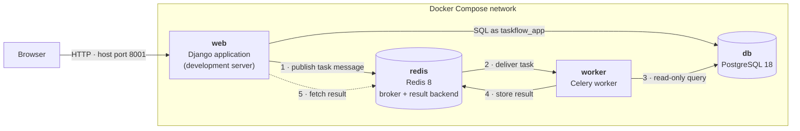
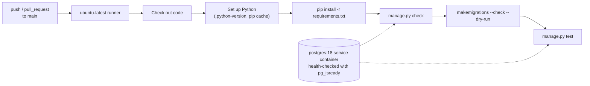
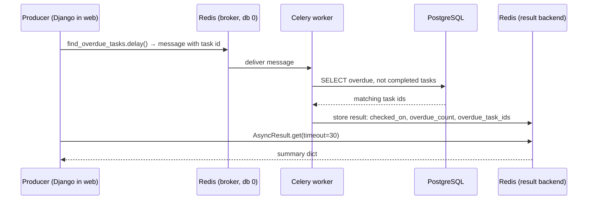
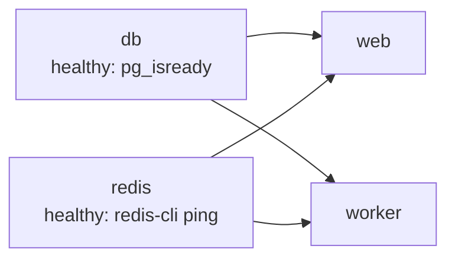

# TaskFlow — A Production-Oriented Django Application & Infrastructure Engineering Project

[](https://github.com/ADITYA8405/TaskFlow/actions/workflows/ci.yml)


TaskFlow is a multi-user task management web application built with Django. It is
also a hands-on infrastructure project: the same application runs as a set of
containerised services — Django, PostgreSQL, Redis, and a Celery worker — and every
change is verified by a PostgreSQL-backed GitHub Actions pipeline.

> **Status:** a development-stage project. It runs locally and in Docker Compose on a
> developer machine. It is **not** deployed anywhere and is not production-ready; see
> [Current limitations](#current-limitations).

---

## Table of Contents

- [Overview](#overview)
- [Key Features](#key-features)
- [Architecture](#architecture)
- [Technology Stack](#technology-stack)
- [Project Structure](#project-structure)
- [Background Task Processing](#background-task-processing)
- [Docker and Container Architecture](#docker-and-container-architecture)
- [Database and Configuration](#database-and-configuration)
- [CI and Automated Testing](#ci-and-automated-testing)
- [Getting Started](#getting-started)
- [Engineering Decisions and Trade-offs](#engineering-decisions-and-trade-offs)
- [Future Improvements](#future-improvements)
- [License](#license)

---

## Overview

**What it is.** TaskFlow lets each registered user create, organise, and track their
own tasks with a status, a priority, and an optional due date. A dashboard summarises
progress and highlights overdue work.

**The problem it addresses.** Personal task lists are a familiar domain, which keeps the
business logic easy to reason about. That leaves room to focus on the engineering
questions that real backend services have to answer: how users' data is isolated, how
configuration and secrets are managed, how the application talks to a real database,
how slow or periodic work is moved out of the request cycle, and how changes are
verified automatically.

**Why it was built.** To practise backend and infrastructure skills end to end on a
codebase small enough to understand completely — from a Django view down to the
container network and the CI runner.

**What makes it more than a basic CRUD project:**

| Area | What the project demonstrates |
| --- | --- |
| Data isolation | Every task query is scoped to the signed-in user; other users' tasks return 404. |
| Configuration | Environment-driven settings that switch between SQLite and PostgreSQL and fail fast on missing values. |
| Database | PostgreSQL 18 as the containerised application database, accessed by a non-superuser application role. |
| Asynchronous work | Celery with Redis as broker and result backend, running in a dedicated worker container. |
| Containerisation | A Dockerfile and a four-service Docker Compose stack with health-checked start-up ordering. |
| Quality gates | 56 automated tests and a GitHub Actions workflow running Django checks, a migration check, and the test suite against PostgreSQL. |
| Secret hygiene | No credentials in the image or in Git; database admin and application credentials kept in separate files. |

---

## Key Features

### Application layer

| Feature | What it provides |
| --- | --- |
| **Registration and authentication** | Sign-up with username, email, and password (Django's password validators apply), plus login and POST-only logout using Django's built-in auth views. |
| **Per-user ownership and isolation** | Each task has an `owner`. List, edit, and delete views filter by `owner=request.user`, so a user can never see or change another user's task — a request for someone else's task ID returns 404 rather than revealing that it exists. |
| **Task CRUD** | Create, edit, and delete tasks through server-rendered forms. Deletion uses a confirmation page and only happens on POST. |
| **Status and priority** | Status is *Pending*, *In Progress*, or *Completed*; priority is *Low*, *Medium*, or *High*. Both are model-level choices, so invalid values are rejected by form validation. |
| **Due dates and overdue tracking** | Optional due date accepted as `DD-MM-YYYY`, `DD/MM/YYYY`, or `YYYY-MM-DD`. A task is overdue when its due date is before today and it is not completed. |
| **Search and filtering** | Case-insensitive title search plus status and priority filters, combinable through query parameters (`?search=`, `?status=`, `?priority=`). Results are ordered newest first. |
| **Dashboard statistics** | Totals for all, completed, pending, in-progress, and overdue tasks, and a completion percentage, computed in a single aggregate database query. |
| **Django admin** | The `Task` model is registered with the Django admin for staff users, alongside Django's built-in user management. |

### Infrastructure and backend engineering

| Feature | What it provides |
| --- | --- |
| **PostgreSQL** | The Docker stack's application database (`postgres:18-alpine`) with a persistent named volume. SQLite remains the zero-configuration default for local development. |
| **Dockerfile** | A reproducible Python 3.13 image containing the application and its pinned dependencies, with no secrets baked in. |
| **Docker Compose** | One command starts four cooperating services — `web`, `db`, `redis`, `worker` — on a private network, in a dependency-safe order. |
| **Separate web and worker services** | The web server handles HTTP; the Celery worker runs background jobs. They share one image and configuration but run as independent processes that can be restarted or scaled separately. |
| **Redis** | Message broker that queues Celery tasks, and result backend that stores their return values for 24 hours. |
| **Asynchronous task execution** | A read-only Celery task, `find_overdue_tasks`, runs in the worker against PostgreSQL and returns a summary of overdue tasks. |
| **GitHub Actions CI** | Every push and pull request to `main` runs Django's system check, a missing-migration check, and the full test suite against a PostgreSQL 18 service container. |
| **Automated tests** | 56 tests covering models, forms, views, access control, filters, dashboard statistics, authentication, and the Celery task. |

---

## Architecture

### Runtime (Docker Compose)



| Component | Responsibility | Communicates with |
| --- | --- | --- |
| **Browser** | Renders server-generated HTML pages and submits forms. | `web` over HTTP on `127.0.0.1:8001` (mapped to container port 8000). |
| **web** | Runs Django: routing, authentication, views, forms, templates, ORM. Acts as the Celery *producer* when code calls `.delay()`. | `db` on `db:5432`; `redis` on `redis:6379`. |
| **db** | Stores all persistent data: users, sessions, tasks, migration history. | Accepts connections from `web` and `worker` on the Compose network. |
| **redis** | Queues task messages (broker) and holds task results (result backend). Not used for application data. | Reached by `web` and `worker`; not published to the host. |
| **worker** | Celery process that consumes task messages, runs the task code inside Django, and writes the return value to the result backend. | `redis` for messages and results; `db` for task queries. |

All service-to-service traffic uses Compose's internal DNS names (`db`, `redis`). Only
`web` publishes a port to the host.

### CI pipeline (GitHub Actions)

CI runs on GitHub's infrastructure and is independent of the Compose stack. It does not
use Docker Compose, Redis, or a Celery worker.



---

## Technology Stack

| Technology | Purpose in TaskFlow | Why it is used |
| --- | --- | --- |
| **Python 3.13** | Application language (pinned in `.python-version` and the Docker base image). | Current, supported Python release required by Django 6.1. |
| **Django 6.1** | Web framework: ORM, authentication, forms, templates, admin, test runner. | Batteries-included framework with mature security defaults. |
| **PostgreSQL 18** | Application database in Docker and in CI. | Production-grade relational database with strong integrity guarantees and concurrent access. |
| **SQLite** | Default database for local, non-Docker development. | Zero setup for quick local work and test runs. |
| **psycopg 3** | PostgreSQL driver used by Django (`psycopg[binary]`). | Django's recommended modern PostgreSQL adapter. |
| **Celery 5.7** | Defines and executes background tasks in a worker process. | Standard, well-supported task queue for Django projects. |
| **Redis 8** | Celery message broker and result backend (`redis:8-alpine`). | Lightweight, fast, and natively supported by Celery. |
| **Docker** | Builds the application image (`python:3.13-slim`). | Identical runtime on any machine; dependencies isolated from the host. |
| **Docker Compose** | Defines and runs the four-service local stack. | Declarative multi-container orchestration with health-check-aware start-up. |
| **GitHub Actions** | CI workflow in `.github/workflows/ci.yml`. | Integrated with the repository; supports service containers for a real PostgreSQL in CI. |
| **python-dotenv** | Loads a local `.env` file into the environment. | Keeps configuration out of source code for local development. |
| **Django templates + CSS** | Server-rendered HTML with a single hand-written stylesheet. | No frontend build step or JavaScript framework is needed for this UI. |

All Python dependencies, including transitive ones, are pinned to exact versions in
`requirements.txt`.

---

## Project Structure

```text
.
├── .github/
│   └── workflows/
│       └── ci.yml                  # GitHub Actions CI workflow
├── apps/
│   ├── accounts/                   # Registration and authentication
│   │   ├── forms.py                # RegisterForm (UserCreationForm + required email)
│   │   ├── views.py                # register view
│   │   ├── urls.py                 # register/, login/, logout/
│   │   ├── tests.py                # 12 auth tests
│   │   ├── templates/accounts/
│   │   │   ├── login.html
│   │   │   └── register.html
│   │   └── admin.py, apps.py, models.py   # Django scaffolding (no custom models)
│   └── tasks/                      # Task domain
│       ├── models.py               # Task model
│       ├── forms.py                # TaskForm (multi-format due date input)
│       ├── views.py                # dashboard/list, create, edit, delete
│       ├── urls.py                 # task routes
│       ├── tasks.py                # Celery task: find_overdue_tasks
│       ├── admin.py                # registers Task with the admin
│       ├── tests.py                # 44 tests incl. the Celery task
│       ├── migrations/
│       │   ├── 0001_initial.py
│       │   └── 0002_task_owner.py
│       ├── templates/tasks/
│       │   ├── base.html           # shared layout and navigation
│       │   ├── task_list.html      # dashboard, filters, task list
│       │   ├── task_form.html      # create page
│       │   ├── task_edit.html      # edit page
│       │   ├── _form_fields.html   # form fields shared by create/edit
│       │   └── task_confirm_delete.html
│       └── static/tasks/
│           ├── css/style.css       # application stylesheet
│           └── js/app.js           # empty placeholder, not loaded by any template
├── config/                         # Project package
│   ├── __init__.py                 # loads the Celery app at Django start-up
│   ├── celery.py                   # Celery application and autodiscovery
│   ├── settings.py                 # environment-driven settings
│   ├── urls.py                     # root URL configuration
│   └── asgi.py, wsgi.py            # server entry points
├── .dockerignore                   # keeps secrets, venvs, databases out of the image
├── .env.example                    # template for local .env (placeholders only)
├── .gitignore
├── .python-version                 # Python 3.13, used by CI
├── Dockerfile                      # application image
├── compose.yaml                    # web, db, redis, worker services
├── LICENSE
├── manage.py
└── requirements.txt                # pinned dependencies
```

### Responsibilities

| Path | Responsibility |
| --- | --- |
| `apps/accounts/` | User sign-up (`RegisterForm`, `register` view) and wiring of Django's `LoginView` and `LogoutView`. Uses Django's built-in `User` model. |
| `apps/tasks/` | The task domain: model, form, views, URLs, templates, static assets, the Celery task, and most tests. |
| `apps/tasks/models.py` | `Task` with `owner` (FK to user, nullable), `title`, `description`, `due_date`, `status`, `priority`, `created_at`, `updated_at`. |
| `apps/tasks/views.py` | Function-based views, all `@login_required` and owner-scoped. `task_list` also builds the dashboard statistics. |
| `apps/tasks/tasks.py` | `find_overdue_tasks`, a read-only Celery task. |
| `apps/tasks/tests.py` | Tests for the model, form, views, access control, filters, dashboard statistics, and the Celery task. |
| `config/settings.py` | Loads `.env`, requires `DJANGO_SECRET_KEY`, selects SQLite or PostgreSQL via `DB_ENGINE`, and defines Celery settings. |
| `config/celery.py` | Creates the Celery app, reads `CELERY_*` settings from Django, and autodiscovers `tasks.py` modules in installed apps. |
| `config/__init__.py` | Imports the Celery app when Django starts so `@shared_task` functions bind to it. |
| `config/urls.py` | Mounts the admin at `/admin/`, task views at `/` (and `/tasks/` for backward compatibility), and auth views at `/accounts/`. |
| `Dockerfile` | Builds the image shared by `web` and `worker`. |
| `.dockerignore` | Excludes `.env*` (except `.env.example`), virtual environments, `.git/`, bytecode, SQLite files, and personal notes from the build context. |
| `compose.yaml` | Declares the four services, health checks, dependencies, env files, and the PostgreSQL volume. |
| `.github/workflows/ci.yml` | CI workflow definition. |
| `requirements.txt` | Exact-pinned dependency set for the image, CI, and local installs. |
| `.env.example` | Documents every local environment variable with placeholder values. |
| `manage.py` | Django's command-line entry point. |

### Routes

| URL | View | Notes |
| --- | --- | --- |
| `/` | `task_list` | Dashboard and task list (login required). Also available under `/tasks/`. |
| `/create/` | `create_task` | Login required. |
| `/edit/<id>/` | `edit_task` | Owner only; 404 otherwise. |
| `/delete/<id>/` | `delete_task` | Owner only; GET shows confirmation, POST deletes. |
| `/accounts/register/` | `register` | Redirects to login on success. |
| `/accounts/login/` | `LoginView` | Redirects to `/` on success. |
| `/accounts/logout/` | `LogoutView` | POST only; redirects to login. |
| `/admin/` | Django admin | Staff users only. |

---

## Background Task Processing

### Why background processing

Some work should not run inside an HTTP request: it may be slow, it may need to run on a
schedule, or it may not have a user waiting for it at all. A task queue moves that work
to a separate process so web requests stay fast and the work can be retried, scaled, or
scheduled independently.

### Roles in TaskFlow's setup

| Role | In TaskFlow |
| --- | --- |
| **Producer** | Any Django process that calls `find_overdue_tasks.delay()` — for example a Django shell in the `web` container. |
| **Broker** | Redis database `0` at `redis://redis:6379/0`. Holds task messages until a worker takes them. |
| **Worker** | The `worker` service: `celery -A config worker --loglevel=info`. |
| **Task** | `apps.tasks.tasks.find_overdue_tasks`, discovered automatically by `app.autodiscover_tasks()`. |
| **Result backend** | The same Redis instance. Stores each task's return value; results expire after 24 hours (`CELERY_RESULT_EXPIRES`). |

- **Celery** defines tasks, serialises calls into messages, and runs a pool of worker
  processes that execute them.
- **Redis** only transports messages and stores results. It does not hold application
  data; PostgreSQL remains the single source of truth.

### The `find_overdue_tasks` task

```python
@shared_task
def find_overdue_tasks():
    today = timezone.localdate()
    overdue = (
        Task.objects
        .filter(due_date__lt=today)
        .exclude(status='COMPLETED')
        .order_by('due_date', 'id')
    )
    overdue_ids = list(overdue.values_list('id', flat=True))
    return {
        'checked_on': today.isoformat(),
        'overdue_count': len(overdue_ids),
        'overdue_task_ids': overdue_ids,
    }
```

- It uses the **same overdue rule as the dashboard**: due before today and not
  completed. Tasks without a due date are never overdue.
- It is **system-wide**: it checks tasks for all users, not just one.
- It is **read-only by design**. It only runs a `SELECT` and returns a JSON-serialisable
  summary. Changing records from a background job would raise questions about retries,
  concurrent edits, and auditing that this project does not yet address, so the task
  reports and leaves decisions to the application. A test asserts that task rows are
  unchanged after it runs.

### Execution flow



1. `.delay()` returns immediately with an `AsyncResult` holding the task ID.
2. The worker receives the message, runs the function inside a fully configured Django
   environment, and connects to PostgreSQL with the application role.
3. The return value is written to Redis under the task ID.
4. The caller retrieves it with `result.get()` (or checks `result.state`).

> **Scope:** TaskFlow currently demonstrates **on-demand** task execution. No view
> enqueues the task, and **Celery Beat is not configured**, so nothing runs on a
> schedule. Retries and error handling policies are not yet defined.

---

## Docker and Container Architecture

### Why Docker

Docker gives every developer — and every future deployment target — the same Python
version, system libraries, and dependency set. Compose then turns a multi-process
system (web server, database, broker, worker) into a single declarative file.

### The image

```dockerfile
FROM python:3.13-slim
ENV PYTHONDONTWRITEBYTECODE=1
ENV PYTHONUNBUFFERED=1
WORKDIR /app
COPY requirements.txt .
RUN pip install --no-cache-dir -r requirements.txt
COPY . .
CMD ["python", "manage.py", "runserver", "0.0.0.0:8000"]
```

- Dependencies are installed **before** the source is copied, so code-only changes reuse
  the cached dependency layer.
- The image is tagged `taskflow-web:dev` and is used by both `web` and `worker`. The
  worker overrides `CMD` with the Celery command.
- Source code is copied into the image (no bind mount), so code changes require a
  rebuild.
- It is explicitly a **development image**: it runs Django's development server and runs
  as root.

### Services

| Service | Image | Role | Host port | Health check |
| --- | --- | --- | --- | --- |
| `web` | `taskflow-web:dev` (built) | Django on the development server | `8001 → 8000` | none |
| `worker` | `taskflow-web:dev` | `celery -A config worker --loglevel=info` | none | none |
| `db` | `postgres:18-alpine` | Application database | none | `pg_isready -h 127.0.0.1` every 5 s |
| `redis` | `redis:8-alpine` | Celery broker and result backend | none | `redis-cli ping` every 5 s |

### Start-up ordering



`web` and `worker` both declare `depends_on` with `condition: service_healthy` for `db`
and `redis`, so they start only after PostgreSQL accepts connections and Redis answers
`PING`. The PostgreSQL check uses TCP (`-h 127.0.0.1`) deliberately: during first-time
initialisation the official image runs a temporary socket-only server, and a socket-based
check could report healthy too early.

### Persistence

PostgreSQL data lives in the named volume `postgres_data`, mounted at
`/var/lib/postgresql`. It survives `docker compose stop`, `docker compose down`, image
rebuilds, and container recreation. Redis has no named volume: queued messages and stored
results are treated as disposable.

### Networking and exposure

- Services reach each other by service name on the Compose network: Django connects to
  `db:5432` and `redis:6379`.
- Only `web` is published to the host, at `http://127.0.0.1:8001`.
- Redis is **not** published. It has no password, and nothing outside the stack needs it,
  so keeping it on the internal network limits who can read or inject task messages.
  PostgreSQL is not published either.

### Secrets and environment variables

| File | Used by | Contents | In Git? | In image? |
| --- | --- | --- | --- | --- |
| `.env.docker` | `db` | PostgreSQL bootstrap (admin) database, user, and password | No | No |
| `.env.docker.app` | `web`, `worker` | Django secret key and application-role database settings | No | No |
| `compose.yaml` `environment:` | `web`, `worker` | `CELERY_BROKER_URL=redis://redis:6379/0` (not a secret) | Yes | No |

- `.gitignore` excludes `.env` and `.env.*` (except `.env.example`).
- `.dockerignore` applies the same rule to the build context, so env files are never
  copied into the image. Compose injects them at container start instead.
- The `db` container never receives the Django secret key, and `web` and `worker` never
  receive the database admin password.

---

## Database and Configuration

### Environment-based settings

`config/settings.py` reads all deployment-specific values from the environment. A local
`.env` is loaded with `python-dotenv` if present; real environment variables always take
priority.

| Variable | Required | Purpose |
| --- | --- | --- |
| `DJANGO_SECRET_KEY` | Always | Django's signing key. Start-up fails with `ImproperlyConfigured` if missing. |
| `DB_ENGINE` | No | `sqlite` (default) or `postgres`. Any other value raises `ImproperlyConfigured`. |
| `POSTGRES_DB`, `POSTGRES_USER`, `POSTGRES_PASSWORD`, `POSTGRES_HOST`, `POSTGRES_PORT` | When `DB_ENGINE=postgres` | Connection settings. If any is empty, the error names the missing variables but never prints values. |
| `CELERY_BROKER_URL` | No | Broker URL. Defaults to `redis://127.0.0.1:6379/0`; Compose sets `redis://redis:6379/0`. |
| `CELERY_RESULT_BACKEND` | No | Defaults to the broker URL. |

`.env.example` is the committed template for local development. It contains placeholders
only.

### Admin and application credentials

The Docker database uses two PostgreSQL roles:

| Role | Defined in | Privileges | Used by |
| --- | --- | --- | --- |
| Bootstrap/admin role (e.g. `taskflow_user`) | `.env.docker` | Superuser created by the PostgreSQL image on first start | `db` initialisation and manual administration |
| `taskflow_app` | `.env.docker.app` | `LOGIN`, `CREATEDB` (for test databases), `CONNECT`/`TEMPORARY` on the database, `USAGE`/`CREATE` on schema `public`. Not a superuser. | `web` and `worker` |

If the application were compromised, it could not alter roles or reach other databases
as a superuser. The application role is created manually (see
[Getting Started](#2-create-the-application-role)); Compose does not create it.

### Why secrets are not committed

Credentials in Git persist in history, are copied to every clone, and are hard to
revoke. TaskFlow keeps them in ignored files, injects them at runtime, and uses only
disposable, clearly labelled values in CI.

### Migrations

Schema changes are tracked in `apps/tasks/migrations/` (`0001_initial`,
`0002_task_owner`) alongside Django's built-in app migrations. Migrations are applied
explicitly with `manage.py migrate`; containers do not apply them automatically on
start. CI fails if a model change has no matching migration.

---

## CI and Automated Testing

### Workflow: `.github/workflows/ci.yml`

| Aspect | Configuration |
| --- | --- |
| Triggers | `push` and `pull_request` to `main` |
| Runner | `ubuntu-latest`, 15-minute timeout, `contents: read` permissions |
| Python | Version read from `.python-version` (3.13) via `actions/setup-python@v7`, with pip caching keyed on `requirements.txt` |
| Database | `postgres:18` service container, health-checked with `pg_isready` before steps run |
| Configuration | Job-level environment variables with disposable CI-only values; `DB_ENGINE=postgres` |
| Install | `python -m pip install -r requirements.txt` |
| Step 1 | `python manage.py check` — Django system checks; also proves settings load from the environment |
| Step 2 | `python manage.py makemigrations --check --dry-run` — fails if models and migrations are out of sync |
| Step 3 | `python manage.py test` — creates a test database on PostgreSQL, runs all tests, drops it |

Redis and Celery workers are not needed in CI: the Celery tests call the task with
`.apply()`, which executes it in-process without a broker.

### Test suite

56 tests built on Django's `TestCase`:

| Area | Tests |
| --- | --- |
| Task model | 4 |
| Task form, including date formats and invalid choices | 8 |
| Anonymous access redirects | 2 |
| Task list, create, edit, delete views, including cross-user 404s | 13 |
| Search and filtering | 8 |
| Dashboard statistics | 5 |
| Celery task: overdue, completed, not-yet-due, no due date, read-only | 4 |
| Registration | 5 |
| Login and logout | 7 |

### Verified results

- **Locally:** all 56 tests pass on SQLite, inside the Docker `web` container against
  PostgreSQL 18, and against a disposable PostgreSQL 18 container using the CI
  configuration.
- **GitHub Actions:** the first workflow run on `main` (commit `fc9b9d4`) passed all steps,
  including 56 tests on Python 3.13 with the PostgreSQL 18 service. The badge at the top of
  this README shows the latest status.

---

## Getting Started

### Prerequisites

- Git
- Python 3.13 (for local development)
- Docker with Docker Compose v2 (for the container stack)

### Clone the repository

```bash
git clone https://github.com/ADITYA8405/TaskFlow.git
cd TaskFlow
```

### Option A — Local development (SQLite)

The quickest way to run the web application. Redis and Celery are not required.

```bash
python3.13 -m venv venv
source venv/bin/activate            # Windows: venv\Scripts\Activate.ps1
python -m pip install -r requirements.txt
cp .env.example .env                # Windows: Copy-Item .env.example .env
```

Generate a secret key and paste it into `.env` as `DJANGO_SECRET_KEY='...'`:

```bash
python -c "from django.core.management.utils import get_random_secret_key as k; print(k())"
```

Keep `DB_ENGINE=sqlite`, then:

```bash
python manage.py migrate
python manage.py createsuperuser    # optional, for /admin/
python manage.py runserver
```

Open http://127.0.0.1:8000/.

To use a local PostgreSQL server instead, set `DB_ENGINE=postgres` and fill in the
`POSTGRES_*` values in `.env`. To run Celery outside Docker you would also need a local
Redis server at the `CELERY_BROKER_URL` address.

### Option B — Docker Compose (PostgreSQL, Redis, Celery)

The Docker env files are intentionally not committed. Create them yourself, use strong
generated passwords, and restrict their permissions.

#### 1. Create `.env.docker` and start the database

```dotenv
# .env.docker — read by the db service only
POSTGRES_DB=taskflow
POSTGRES_USER=taskflow_user
POSTGRES_PASSWORD='replace-with-a-strong-generated-password'
```

```bash
chmod 600 .env.docker
docker compose up -d --wait db
```

The PostgreSQL image reads these values only when it initialises an empty volume.

#### 2. Create the application role

Open `psql` inside the `db` container as the admin user from `.env.docker`. Local
connections inside the container do not prompt for a password.

```bash
docker compose exec db psql -U taskflow_user -d taskflow
```

```sql
CREATE ROLE taskflow_app LOGIN CREATEDB;
\password taskflow_app
GRANT CONNECT, TEMPORARY ON DATABASE taskflow TO taskflow_app;
GRANT USAGE, CREATE ON SCHEMA public TO taskflow_app;
\q
```

`\password` prompts for the password and sends only a hash to the server, so the password
never appears in shell history or server logs.

#### 3. Create `.env.docker.app`

```dotenv
# .env.docker.app — read by the web and worker services
DJANGO_SECRET_KEY='replace-with-a-generated-secret-key'
DB_ENGINE=postgres
POSTGRES_DB=taskflow
POSTGRES_USER=taskflow_app
POSTGRES_PASSWORD='the-password-set-with-\password'
POSTGRES_HOST=db
POSTGRES_PORT=5432
```

```bash
chmod 600 .env.docker.app
```

#### 4. Build and start the stack

```bash
docker compose up -d --build --wait
docker compose ps
```

#### 5. Apply migrations and create an admin user

```bash
docker compose exec web python manage.py migrate
docker compose exec web python manage.py createsuperuser
```

Because `taskflow_app` runs the migrations, it owns the tables it creates.

#### 6. Open the application

| Page | URL |
| --- | --- |
| Dashboard | http://127.0.0.1:8001/ |
| Register | http://127.0.0.1:8001/accounts/register/ |
| Login | http://127.0.0.1:8001/accounts/login/ |
| Admin | http://127.0.0.1:8001/admin/ |

#### 7. Verify the worker and run the task

```bash
docker compose logs worker          # look for "find_overdue_tasks" and "ready"
docker compose exec web python manage.py shell -c \
  "from apps.tasks.tasks import find_overdue_tasks; print(find_overdue_tasks.delay().get(timeout=30))"
```

Example output:

```text
{'checked_on': '2026-11-24', 'overdue_count': 0, 'overdue_task_ids': []}
```

#### Everyday commands

```bash
docker compose up -d --build --wait   # rebuild after code or dependency changes
docker compose logs -f web worker     # follow logs
docker compose stop                   # stop containers, keep everything
docker compose down                   # remove containers and network, keep the volume
```

> **Warning:** do not add `-v` to `docker compose down` unless you intend to delete the
> `postgres_data` volume and every record in the Docker database.

### Running tests

```bash
# Local (uses the settings in .env)
python manage.py test

# Inside Docker, against PostgreSQL (uses a temporary test_taskflow database)
docker compose exec web python manage.py test

# The same checks CI runs
python manage.py check
python manage.py makemigrations --check --dry-run
```

---

## Engineering Decisions and Trade-offs

| Decision | Rationale | Trade-off |
| --- | --- | --- |
| **PostgreSQL for the container stack and CI; SQLite kept for local work** | PostgreSQL matches what a real deployment would use: concurrent connections, roles and privileges, strict typing. Testing on it in CI catches database-specific behaviour. | Two supported engines; SQLite-only runs can miss PostgreSQL-specific issues, which is why CI uses PostgreSQL. |
| **Separate `web` and `worker` processes** | Background jobs cannot block or crash the web server, and each can be restarted or scaled independently. | Two processes to run and monitor; both must be rebuilt together because they share the image. |
| **Redis as broker and result backend** | One small service covers both roles; first-class Celery support; simple to operate locally. | Without persistence configuration, queued tasks and results are lost if the container is recreated. RabbitMQ would offer stronger delivery guarantees as a broker. |
| **Docker Compose for orchestration** | Right-sized for a single-host, four-service development stack; health-checked dependencies are declared in one file. | Single host only; no rolling updates, self-healing, or multi-node scheduling. |
| **PostgreSQL-backed CI** | Tests run against the same database family as the Docker stack, on every push and pull request. | Slightly slower than SQLite and needs a service container. |
| **Non-superuser application role** | Limits the impact of an application-level compromise. | An extra manual setup step that Compose does not automate. |
| **No Kubernetes or Terraform** | One application, one host, no cloud deployment yet. Kubernetes and Terraform solve multi-node orchestration and cloud provisioning — problems this project does not have yet. Adding them now would add complexity without benefit. | Revisit once there is a real deployment target. |

### Current limitations

- **Development server only.** Both Docker and local runs use `manage.py runserver`.
  There is no Gunicorn/Uvicorn or reverse proxy.
- **Development settings are hardcoded.** `DEBUG = True` and `ALLOWED_HOSTS = []` are
  in `config/settings.py`, and `STATIC_ROOT`/`collectstatic` are not configured.
- **No deployment.** The project runs only on a developer machine; there is no cloud
  hosting, domain, or TLS.
- **Containers run as root**, and Celery logs a warning about it.
- **Redis has no authentication or persistence configuration.** It is protected only by
  not being published to the host.
- **Background tasks are on-demand only.** There is no Celery Beat schedule, retry
  policy, or monitoring of task failures, and no view enqueues the task.
- **Manual setup steps.** The application database role must be created by hand, and
  migrations are not applied automatically on container start.
- **No health checks for `web` or `worker`.** Compose reports them as running, not
  healthy.
- **Registration does not enforce unique email addresses.**
- **Tasks with no owner** (the `owner` field is nullable for historical data) do not
  appear in any user's dashboard; they are visible in the admin.

---

## Future Improvements

These are **planned, not implemented**, roughly in priority order.

1. **Production server and reverse proxy.** Gunicorn (or Uvicorn for ASGI) behind Nginx
   or a managed load balancer, with static files collected and served properly.
2. **Hardened configuration and containers.** `DEBUG` and `ALLOWED_HOSTS` from the
   environment, secure cookie and HTTPS settings, `check --deploy` in CI, a non-root
   container user, and a slimmer production image.
3. **Redis hardening.** Authentication, and persistence (AOF or RDB on a volume) where
   losing queued tasks matters.
4. **Reliable background jobs.** Celery Beat for a scheduled overdue check, retry policies
   with back-off, idempotent task design, and time limits.
5. **Observability.** Structured logging, error tracking, health endpoints for `web` and
   `worker`, and task monitoring (for example Flower).
6. **Cloud deployment.** A managed PostgreSQL and Redis, container hosting, secrets
   management, and a CD stage after CI.

---

## License

Released under the [MIT License](LICENSE).
